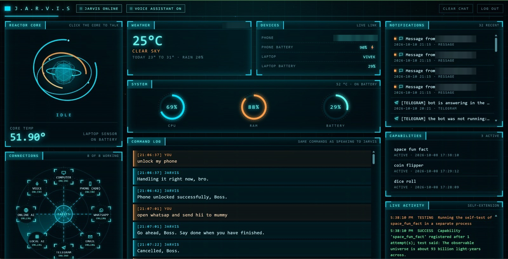

# JARVIS — a voice assistant that writes its own new features, safely

A Windows assistant that listens, controls the laptop and an Android phone, and answers on Telegram and in a live web
dashboard. When it is asked for something it cannot do yet, it **generates the capability with an LLM, statically
verifies the code, tests it in a sandboxed process, and only then registers and runs it** — with a deny-list, a retry
budget and automatic rollback.



   

## Highlights

- **Self-extending capability engine.** "Jarvis, add a feature that flips a coin" produces a new, working module in about
  half a minute: prompt → code → AST safety check → self-test in a separate process → registry → the request is executed.
  The retry and rollback paths are covered by unit tests with a scripted model.
- **Safety is designed in, not bolted on.** Generated code may only import an allow-list of pure-Python modules, has no
  file, process or network access of its own, runs its test in a child process stripped of API keys, and can never
  override a built-in command. Requests about deleting, money or credentials are refused before any model is called.
- **One command pipeline, four front ends.** Microphone, Telegram, the web dashboard and the terminal all feed the same
  router, so every feature — including the self-written ones — works everywhere at once.
- **Three LLM back ends with automatic fallback**: Gemini → Groq → a local Ollama model. A one-time benchmark decides
  whether the local model runs on the integrated GPU (it did here: about 19 tokens/s against 7 on the CPU).
- **Tested against the real thing.** 280 unit tests, a 201-check end-to-end self-test and a 35-check Selenium browser
  suite. On top of that, features were exercised on real hardware and services — a real phone, a real mailbox, real
  model calls — rather than only against mocks.

## Why I built this

I wanted an assistant I would actually use every day — one that can message someone on WhatsApp through my phone, read
my notifications aloud, and keep working when a cloud API runs out of quota. The interesting engineering problem turned
out to be the last step: letting it grow new abilities on request **without** ever giving model-written code the power
to damage the machine or the assistant itself. Most of the design effort went into that boundary.

## Features

| Area | In practice |
|---|---|
| **Voice** | Wake word and speech recognition in English, Hindi and Hinglish; speaker verification so only the owner is obeyed; natural text-to-speech; barge-in (it stops talking when you start). |
| **Laptop control** | Apps, typing, key presses, search, screenshots, timers, to-do list, weather, system status, and multi-step "skills" that can be taught by voice. |
| **Android phone over ADB** | WhatsApp messages and calls, notifications read aloud, incoming-call handling, battery, do-not-disturb, screen reading without blind taps. |
| **Self-healing phone link** | Fixed debugging port, automatic reconnect, a port-scan rescue after a phone restart, and a 13 KB companion app (`jarvis_addons/phone_helper`, Java, built without Gradle) that re-enables wireless debugging on the home Wi-Fi. |
| **Capability engine** | LLM-written modules with static verification, sandboxed tests, registry and rollback — see [the safety design](#safety-design-of-the-capability-engine). |
| **Telegram bot** | The full command pipeline from anywhere; voice messages in, text and voice out; only the owner's account is obeyed. |
| **Web dashboard** | Password-protected local page: chat with persistent history, real CPU / RAM / battery / temperature, weather, phone state, a hub of the real connections, notifications, and the self-extension steps streaming live. Its centre piece is a WebGL (Three.js) reactor that reflects the assistant's state. Works at phone width. |
| **Email** | Important-mail detection with deadline extraction and WhatsApp follow-up reminders that stop once the mail is answered. |
| **Network discovery** | Lists the devices on the home network with maker and a conservative type guess — "unknown" rather than a confident wrong answer. Discovery only; it never logs into anything. |
| **Resource governor** | Background work pauses on battery, under load or when the laptop is hot; the local model is unloaded when idle; one-click off / on. |

## Architecture

```text
 microphone ─► wake word ─► speech-to-text ─► speaker check ─┐
 Telegram bot (text or voice message) ──────────────────────┤
 Dashboard (typed, or recorded in the browser) ─────────────┤
 Terminal:  live_cmd_console.py --say "..." ────────────────┤
                                                            ▼
                                                  route_and_execute()
                                                            │
        ┌──────────────────┬──────────────────┬─────────────┴─────┐
        ▼                  ▼                  ▼                   ▼
   fixed rules       taught skills      intent matcher     capability engine
   (time, phone,     (multi-step        (local model,      (self-written modules;
    WhatsApp ...)     macros)            LLM as helper)     asked LAST, so they can
        │                  │                  │              never shadow a built-in)
        └──────────────────┴─────────┬────────┴───────────────────┘
                                     ▼
                actions: laptop · phone over ADB · email · LLM answer
                                     │
                                     ▼
              speak() ─► speakers / Telegram reply / dashboard chat
```

- **`live_cmd_console.py`** — the assistant core: voice loop, router, built-in features and its own `--full-test`.
- **`jarvis_agent/`** — an autonomous agent for coding, data, research and website-building tasks.
- **`jarvis_addons/`** — add-ons that attach to the running assistant by wrapping its functions. Each installs itself
  independently, so a faulty add-on cannot stop the assistant.

| Add-on | Role |
|---|---|
| `capability.py` | self-extending capability engine |
| `dashboard.py`, `dashboard_ui/` | web dashboard (Flask + a single-file front end) |
| `telegram_bot.py`, `callmebot.py` | Telegram remote control and alert calls |
| `phone_link.py`, `phone_helper/`, `phone_compat.py`, `pattern_lock.py` | the phone connection |
| `perf.py`, `power.py` | resource governor, one-click off / on |
| `contact_sync.py`, `network_discovery.py`, `voice_ort.py`, `usage_log.py`, `config_file.py` | contacts, network scan, voice-lock fallback, local usage log, settings file |

The Telegram bot and the dashboard run as separate background processes that the assistant starts and keeps alive.

## Safety design of the capability engine

Letting software write and run its own code is only acceptable with hard limits. These are implemented in
[`jarvis_addons/capability.py`](jarvis_addons/capability.py) and exercised by
[`tests/test_capability.py`](jarvis_addons/tests/test_capability.py):

1. **Deny-list before generation.** A request that touches deleting, payments or credentials is never sent to a model.
   It is written to a file for the owner's explicit approval instead.
2. **One folder only.** Generated code is written to `jarvis_addons/capabilities/` and nowhere else; the engine never
   edits the core.
3. **Static verification before first execution** (Python `ast`): an allow-list of pure-Python imports; no file access,
   subprocesses or sockets; no `eval`, `exec`, `open` or `getattr`; no dunder attributes. Anything beyond pure
   computation goes through a small read-only context (`ask_ai`, `http_get`, `read_text`, `list_dir`) that refuses the
   assistant's own data and key files.
4. **Sandboxed self-test.** The module's test runs in a separate interpreter process with a time limit and an
   environment stripped of API keys. A crash or an endless loop there cannot affect the assistant.
5. **Bounded retries with real feedback, then rollback.** Up to three attempts; the actual error is given back to the
   model. If the last attempt fails, the file is deleted and nothing is registered.
6. **No hijacking.** A capability is consulted only after every built-in rule has declined the sentence.
7. **Run-time guard.** Every call has a time limit and its exceptions are contained; a capability file changed by hand
   must pass the static check again before it is loaded.
8. **Owner only.** Building a capability requires the verified owner.

The same approach runs through the rest of the project: the dashboard stores only a salted password hash and locks a
device out after five wrong attempts; secrets are masked before anything is spoken, logged or sent; destructive requests
are refused from Telegram and the dashboard; network discovery is restricted to the private network the laptop is on.

## Tech stack

| Layer | Used |
|---|---|
| Language / platform | Python 3.11, Windows 10 / 11 |
| Speech | SpeechRecognition + PyAudio, Vosk, Groq Whisper (speech-to-text), edge-tts (text-to-speech), sherpa-onnx / onnxruntime (speaker verification), noisereduce |
| LLMs | Google Gemini (`google-genai`), Groq, Ollama (local, optional) |
| Automation | Android Debug Bridge, PyAutoGUI, pywin32, psutil |
| Web | Flask, vanilla HTML / CSS / JS, Three.js (WebGL) |
| Storage | SQLite |
| Android | a small Java companion app (boot receiver + JobScheduler) |
| Tests | `unittest`, Selenium with headless Chrome |

## Setup

Requirements: Windows 10 / 11, a microphone, and at least one of a Gemini key, a Groq key or a local Ollama model.
An Android phone on the same Wi-Fi is optional.

```powershell
git clone <this-repo-url> JARVIS
cd JARVIS
.\Install_JARVIS.bat
```

The installer creates a virtual environment, installs the exact tested library set (`requirements.lock.txt`) and runs
the guided first-time setup. To do it by hand instead:

```powershell
py -3.11 -m venv venv
venv\Scripts\python.exe -m pip install -r requirements.txt
copy config.example.json config.json
venv\Scripts\python.exe -m jarvis_addons.config_file --apply
venv\Scripts\python.exe jarvis_setup.py
```

Fill in `config.json` with your own keys before the `--apply` step; it is git-ignored. `jarvis_setup.py` is the optional
guided part (name, phone link, voice enrolment). `adb.exe` (Android platform-tools) and the speech models are not in the
repository; the installer and the setup say where they go. No key, contact or personal setting is stored in the code —
they live in a local SQLite file that is git-ignored.

Run it:

```powershell
.\JARVIS_Launcher.ps1 -Console
venv\Scripts\python.exe live_cmd_console.py --say "what time is it"
venv\Scripts\python.exe -m jarvis_addons.dashboard --run
venv\Scripts\python.exe -m jarvis_addons.telegram_bot --setup
```

These start, in order: the assistant with a visible console, one command from the terminal, the dashboard on
`http://localhost:8765`, and the link to your own Telegram bot.

## Testing

| Suite | Command | Result on the development machine |
|---|---|---|
| Add-on unit tests | `venv\Scripts\python.exe -m unittest discover -s jarvis_addons/tests -t .` | 213 pass |
| Agent unit tests | `venv\Scripts\python.exe -m unittest discover -s jarvis_agent/tests -t .` | 67 pass |
| End-to-end self-test of the assistant | `venv\Scripts\python.exe live_cmd_console.py --full-test` | 201 of 201 checks pass |
| Dashboard in a real browser | `venv\Scripts\python.exe jarvis_addons\tests\browser_test_dashboard.py dashboard_password.txt shots basic` | 35 checks pass |

The browser suite (Selenium, headless Chrome, against the running dashboard) logs in, sends real commands, opens every
card's detail view, verifies that the WebGL scene is rendering and moving, records through a fake microphone, cuts the
backend to check the offline state, and repeats the essentials at phone width.

The unit tests use fakes so that they never touch a real device or account. Separately, features were exercised against
real hardware and services — for example, the phone-link rescue was confirmed by actually closing the phone's debugging
port and watching the assistant find the new one and restore the fixed port.

## Scope and limits

This is a personal project built for one Windows laptop and one Android phone, then generalised so that someone else
can install it with their own keys. It is not hardened for the open internet: the dashboard is meant for a home network
behind its password. After a phone restart, Android itself switches wireless debugging off; the companion app works
around that without root.

## License

[MIT](LICENSE) © 2026 Vivek Prasad
